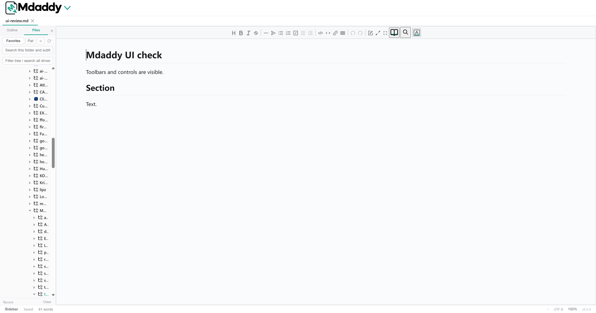

<p align="center">
  
</p>

<p align="center">
  A focused Markdown editor for Windows, with visual editing and direct access to the source.
</p>

<p align="center">
  
</p>

## Features

- Edit Markdown visually or switch to raw-by-line mode with <kbd>Ctrl</kbd>+<kbd>Alt</kbd>+<kbd>M</kbd>.
- Drag groups of tabs from Firefox or Chrome into the editor to create a bulleted list of titled links.
- Paste URLs as separate clickable links, with line breaks preserved.
- Format selected text, work with headings, insert horizontal rules, and collapse code blocks.
- Move the formatting toolbar by right-clicking it and dragging it to the top or a vertical side rail.
- Open several documents in tabs, navigate with the outline, browse folders, and keep favorite folders close.
- Paste and resize images, choose light, dark, eye-care, or warm-paper appearance, and export documents.
- Use Reader mode, then return to editing with the compact **Edit** button.

## Download

Download the standalone Windows app from [GitHub Releases](https://github.com/NinjaKristo/Mdaddy/releases). The current release provides [Mdaddy.exe](https://github.com/NinjaKristo/Mdaddy/releases/download/v0.6.0/Mdaddy.exe).

## Build from source

Requirements: Windows 10 or 11, Node.js, Rust, Microsoft C++ Build Tools, and Git Bash.

```bash
npm install
bash scripts/build-release.sh
```

The script builds the frontend and Windows executable, updates the app icons, copies the executable to `release/Mdaddy.exe`, and runs the release smoke and UI-controls checks. Rust build output is also available under `src-tauri/target/release/`.

## UI and icon guide

See [docs/UI-BUTTONS.md](docs/UI-BUTTONS.md) for the control-to-feature map and artwork locations. Most authored artwork lives in `Assets/`; `public/mdaddy-icon.svg` generates the application icons, including the Windows `.ico`.

## License

Mdaddy is distributed under the MIT License. See [LICENSE](LICENSE) for the license and copyright notice.
